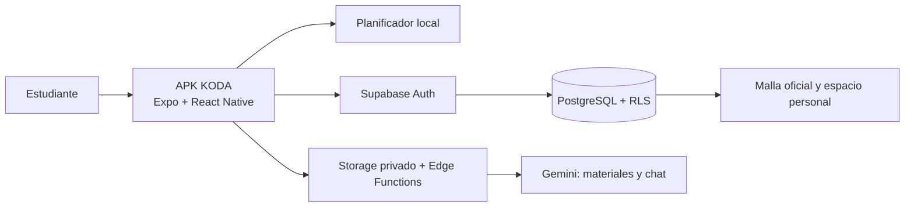

# KODA

> Una app móvil para que estudiantes peruanos lleguen a la semana de exámenes con cursos, temas y tiempo de estudio en orden.

KODA transforma fechas de evaluación, temas pendientes y horas disponibles en un plan de estudio claro. La malla curricular acelera el registro, pero cada curso permanece bajo control del estudiante: puede añadirlo, quitarlo o desactivarlo cuando lo necesite.

## Estado del proyecto

| Área | Estado | Qué incluye hoy |
| --- | --- | --- |
| Fundación y diseño | Listo | Expo Router, TypeScript, diseño claro/oscuro y componentes reutilizables. |
| Cuenta y datos | Listo | Correo, sesión segura, RLS y sincronización; Google funciona cuando el proveedor está habilitado en el entorno correspondiente. |
| Organización | Listo | Cursos, exámenes, temas, disponibilidad y un plan explicable. |
| Catálogo curricular | En crecimiento | Instituciones indexadas, mallas oficiales contrastadas y registro inicial solo con ciclos completos; Continental se incorpora con su plan oficial. |
| Calendario académico | En crecimiento | 9 periodos 2026 con 34 eventos oficiales de matrícula, clases y evaluaciones. |
| Repaso | Listo | Flashcards propias, generación inicial por curso, PDF directo a 8 tarjetas y dominio acumulado. |
| Seguimiento | Listo | Avance por curso, riesgos próximos y recordatorios locales semanales. |
| IA, materiales y simulacros | Listo | PDFs y audios privados con cantidad de tarjetas elegible (1–6), PDF directo a 8 tarjetas, chat útil aun sin material, historial por cuenta y simulacros; la clave de Gemini permanece solo en Supabase. |
| Perfil | Listo | Foto privada de perfil, preferencias, recordatorios, exportación y eliminación de cuenta. |
| Privacidad de cuenta | En cierre de release | Exportación JSON, eliminación definitiva de cuenta y materiales privados; falta publicar las páginas legales en una URL HTTPS. |

## Cómo se conecta todo



La APK solo contiene configuración pública de Supabase. Las reglas RLS hacen que una cuenta no pueda leer ni escribir los datos de otra.

## Empezar desde cero

Estas instrucciones son para cualquier integrante que ya tenga acceso al repositorio privado.

1. Instala [Node.js 22.13+](https://nodejs.org/), [Git](https://git-scm.com/downloads) y [Visual Studio Code](https://code.visualstudio.com/).
2. Abre PowerShell en la carpeta donde guardarás el proyecto.
3. Clona el repositorio y entra en él:

```powershell
git clone https://github.com/sebastianrosasq/KODA.git
cd KODA
```

4. Instala exactamente las dependencias registradas por el equipo:

```powershell
npm ci
```

5. Crea tu configuración local sin subir secretos:

```powershell
Copy-Item .env.example .env
```

6. Pide al responsable la `EXPO_PUBLIC_SUPABASE_URL` y la `EXPO_PUBLIC_SUPABASE_PUBLISHABLE_KEY` del proyecto de desarrollo, y colócalas solo en `.env`. No uses una clave `service_role`.
7. Inicia la app:

```powershell
npm run start
```

Para instalar o probar en Android, sigue [GETTING_STARTED.md](docs/GETTING_STARTED.md). Las validaciones de una modificación son:

```powershell
npx tsc --noEmit
npm test
npm run lint
npx expo-doctor
npx expo export --platform web
```

## Arquitectura del repositorio

```text
KODA/
├── src/app/                 Pantallas y navegación con Expo Router
├── src/components/          Sistema visual reutilizable
├── src/features/            Planificador, sincronización, repaso y recordatorios
├── src/providers/           Sesión, tema y estado del espacio de estudio
├── src/data/                Catálogo disponible sin conexión
├── supabase/migrations/     Esquema y políticas RLS versionados
├── supabase/seed/           Mallas, fuentes y cursos oficialmente contrastados
├── docs/                    Producto, arquitectura, sprints y guías
├── app.json                 Configuración de la APK y plugins Expo
└── eas.json                 Perfiles de compilación Android
```

## Catálogo curricular: regla de confianza

| Estado | Comportamiento en KODA |
| --- | --- |
| `verified` | Se muestra durante el registro, se consulta la malla oficial y se sugieren los cursos del ciclo elegido. |
| `source_identified` | Permanece indexada para el equipo; no se muestra como opción de registro hasta que tenga todos sus cursos contrastados. |

El detalle de instituciones, planes, fuentes y próximos contrastes está en [CURRICULUM_CATALOG_README.md](supabase/seed/CURRICULUM_CATALOG_README.md). Los periodos y eventos oficiales consultados están en [ACADEMIC_CALENDAR.md](docs/ACADEMIC_CALENDAR.md).

## Documentación útil

- [Guía de instalación y primer arranque](docs/GETTING_STARTED.md)
- [Cómo colaborar: ramas, revisiones y commits](CONTRIBUTING.md)
- [Acceso con correo y Google](docs/AUTH_SETUP.md)
- [Calendarios académicos verificados y política de actualización](docs/ACADEMIC_CALENDAR.md)
- [Alcance y 16 casos de uso](docs/PRODUCT_SCOPE.md)
- [Arquitectura, límites de seguridad y recorrido de IA](docs/SYSTEM_ARCHITECTURE.md)
- [Plan S1–S8](docs/SPRINTS.md)
- [Detalle técnico de Sprints 2 y 3](docs/SPRINT_2_3.md)
- [Acceso con correo y Google](docs/AUTH_SETUP.md)
- [Base segura de IA, audios, PDFs y chat](docs/AI_SETUP.md)
- [Modelo freemium, hipótesis de precio y arquitectura de cobro](docs/MONETIZATION.md)
- [Estado de preparación para la presentación](docs/PRESENTATION_READINESS.md)
- [Accesos y secretos por etapa](docs/ACCESS_AND_SECRETS.md)
- [Política de privacidad para publicación](docs/PRIVACY.md)
- [Condiciones de uso para publicación](docs/TERMS.md)

## Reglas del equipo

- Los commits se escriben en español, claros y centrados en un cambio concreto.
- Antes de subir cambios, ejecuta TypeScript y lint.
- No versionar `.env`, claves de Gemini, contraseñas, tokens personales, archivos de firma ni datos reales de estudiantes.
- Para librerías Expo usa `npx expo install nombre-del-paquete`; así se conserva compatibilidad con Expo SDK 57.
- Un curso sugerido nunca reemplaza la decisión del estudiante.
