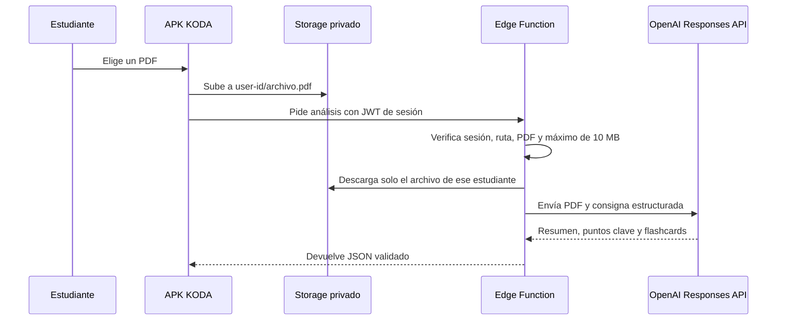

# IA y documentos privados · Sprint 6

La base del Sprint 6 ya está versionada, pero el análisis no se activa hasta que el responsable configure una clave de OpenAI en Supabase. Esto evita exponer una clave, generar gasto inesperado o fingir que la IA está funcionando.

## Flujo seguro



## Lo que ya está preparado

- Bucket privado `koda-study-documents`, limitado a PDF de 10 MB.
- Políticas Storage: una persona solo puede listar, subir, leer, actualizar o eliminar objetos bajo su propio UUID.
- Función `analyze-study-document`, autenticada con JWT de usuario.
- Validación de la ruta, tipo y tamaño antes de contactar a OpenAI.
- Respuesta con JSON estructurado: título, resumen, puntos clave y flashcards.

La función usa `input_file` de la Responses API para que un PDF aporte texto y páginas. El formato de salida se fuerza con JSON Schema estricto. Consulta la [guía oficial de archivos](https://developers.openai.com/api/docs/guides/file-inputs) y la [guía oficial de Structured Outputs](https://developers.openai.com/api/docs/guides/structured-outputs).

## Activación por el responsable

1. Confirma el presupuesto y crea una clave de servidor en OpenAI.
2. En Supabase, guarda `OPENAI_API_KEY` como secreto del proyecto. No la copies a `.env`, GitHub, la APK ni un chat.
3. Opcionalmente define `OPENAI_MODEL`; si no existe, la función solicita `gpt-6-astra`.
4. Despliega la función autenticada:

```powershell
npx supabase functions deploy analyze-study-document
```

5. Prueba con un PDF no sensible en una cuenta de desarrollo antes de habilitar la pantalla para estudiantes.

## Límites que quedan pendientes

- Añadir a la APK el selector y cargador de PDFs con progreso y mensajes de error.
- Aplicar una cuota diaria por estudiante antes de ofrecer IA a todo el grupo.
- Guardar resultados aceptados por el estudiante como resúmenes o flashcards, nunca reemplazarlos automáticamente.
- Probar la función con Deno/Supabase local y con un dispositivo físico antes de marcar S6 como terminado.
