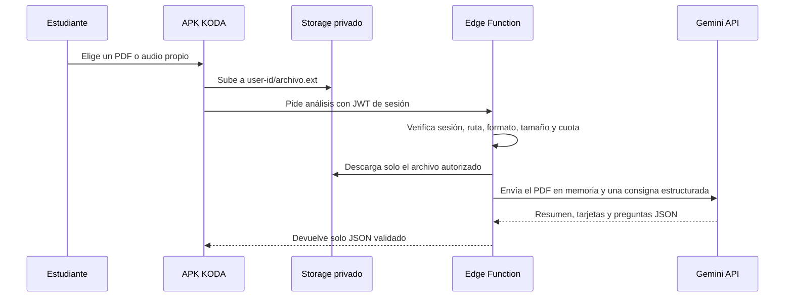

# IA, materiales privados y chat · Sprint 6

KODA usa Gemini únicamente desde una Edge Function de Supabase. La APK no conoce ni puede extraer la clave de Gemini. El modelo inicial es `gemini-3.5-flash-lite`, elegido para análisis de documentos de alto volumen y respuestas estructuradas; se puede reemplazar mediante un secreto sin cambiar la aplicación. El historial del chat se guarda de forma privada por cuenta y se puede borrar desde KODA.

## Flujo seguro



## Protecciones incluidas

- Bucket privado `koda-study-documents`, limitado a PDF o audio de 12 MB.
- Políticas Storage: cada estudiante solo opera objetos cuyo primer directorio es su UUID.
- Tabla de documentos y resultados protegida por RLS; un estudiante no puede leer los de otro.
- Consentimiento explícito antes del primer envío a IA.
- La función verifica JWT, propiedad, tipo y tamaño. El límite diario de la beta es de **3 PDF** y **5 audios** analizados por estudiante (hora de Lima). El chat no impone un límite propio de mensajes; siguen aplicando las protecciones del proveedor y los límites técnicos de longitud.
- El archivo se pasa en memoria a Gemini; KODA no usa el File API de Gemini ni expone enlaces públicos. En React Native se carga como `ArrayBuffer` desde la copia local del selector de documentos, que es el formato soportado por Storage. El chat recibe solamente la pregunta y, si el estudiante lo elige, el análisis ya validado del material.
- Antes de llamar a Gemini, el servidor reclama el material de forma atómica para evitar análisis duplicados por toques repetidos. La cuota se consume solo después de obtener y validar un análisis correcto; una carga o salida inválida no debe descontar un intento.
- Si un texto generado contiene un número dentro de una palabra (por ejemplo, una letra sustituida por `3`), el servidor pide una regeneración puntual una sola vez. Si persiste, no guarda ese análisis corrupto y solicita reintento.
- La respuesta se valida antes de guardarla: título, resumen, puntos clave, hasta 8 flashcards y hasta 5 preguntas de cuatro alternativas.

Formatos de audio: MP3, WAV, M4A, AAC, OGG, FLAC y WEBM. El análisis y el chat son ayudas de repaso, no una fuente académica definitiva: la persona debe contrastar resumen, tarjetas y alternativas con su material.

## Activación o cambio de entorno por el responsable

1. Crea una clave de servidor en [Google AI Studio](https://aistudio.google.com/app/apikey).
2. Guárdala **solo** como secreto de Supabase. Nunca en `.env`, GitHub, la APK ni un chat.

```powershell
npx supabase secrets set GEMINI_API_KEY="tu_clave_privada" GEMINI_MODEL="gemini-3.5-flash-lite"
```

3. Despliega o vuelve a desplegar la función:

```powershell
npx supabase functions deploy analyze-study-document
npx supabase functions deploy study-coach
```

4. Prueba con un PDF o audio no sensible y el chat en una cuenta de desarrollo antes de habilitarlo a más estudiantes. La app muestra “Guardando archivo” y luego “Analizando con IA” para que no se confunda el almacenamiento con el análisis.
5. Consulta las cuotas reales del proyecto en AI Studio antes de aumentar el límite de KODA. El límite local por estudiante evita abusos, pero no sustituye los límites de Google.

## Límites del plan gratuito

Gemini puede cambiar sus cuotas gratuitas por modelo y proyecto. Por eso KODA no promete solicitudes ilimitadas ni usa la clave desde el móvil. Además, los términos de Google pueden tratar los datos del nivel gratuito de forma distinta al nivel de pago; revisa la política vigente y evita enviar información sensible de terceros.

Referencias oficiales: [modelo Gemini Flash-Lite](https://ai.google.dev/gemini-api/docs/models/gemini-3.5-flash-lite), [procesamiento de documentos](https://ai.google.dev/gemini-api/docs/document-processing), [salida estructurada](https://ai.google.dev/gemini-api/docs/structured-output), [cuotas](https://ai.google.dev/gemini-api/docs/rate-limits) y [precios](https://ai.google.dev/gemini-api/docs/pricing).
